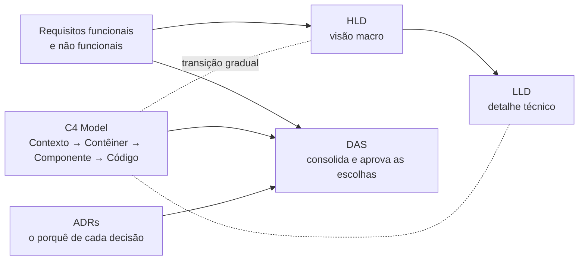

# Documentação de Arquitetura de Soluções

[[Fase 1 - Arquitetura de Software]] · Revisão → [[Revisão - Documentação de Arquitetura de Soluções]]

## Aulas
| # | Aula | Conceitos-chave |
|---|---|---|
| 1 | [[DOC 01 - Introdução à documentação de arquitetura]] | [[Documentação de Arquitetura]], visão geral de todos os tipos |
| 2 | [[DOC 02 - High-Level Design (HLD) e Low-Level Design (LLD)]] | [[HLD e LLD (High-Level Design e Low-Level Design)]], [[Diagrama de Sequência]] |
| 3 | [[DOC 03 - Modelos e diagramas de arquitetura - C4 Model]] | [[C4 Model]] |
| 4 | [[DOC 04 - Requisitos funcionais e não funcionais]] | [[Requisitos Funcionais e Não Funcionais]], [[Arquiteto de Soluções]] |
| 5 | [[DOC 05 - Architecture Decision Records (ADRs)]] | [[ADR (Architecture Decision Record)]] |
| 6 | [[DOC 06 - DAS (Design Approval Sheet)]] | [[DAS (Design Approval Sheet)]] |

## Como os documentos se encaixam

O diagrama é só um mapa de navegação, montado a partir do que as apostilas dizem: o HLD vem antes do LLD, o C4 faz a transição entre os dois e a estrutura do DAS inclui requisitos, diagramas C4 e ADRs (aula 6).

## Material
PDFs em `~/Desktop/FASE 1/Documentação de Arquiteturas de Soluções/`. **As notas resumem apenas o conteúdo escrito nos PDFs.** As figuras (template de ADR de Nygard, exemplos de HLD e LLD, os diagramas do C4, o mapa de requisitos, o processo e o exemplo de ADR) não estão nas notas: quando uma nota cita uma figura, consulte o PDF.

> [!note] Fase
> O nome dos arquivos diz **"Fase 3"**, mas o cabeçalho dentro dos PDFs diz **"FASE 1"**. A disciplina está na Fase 1, junto com as outras.

## Referências
Bass, Clements e Kazman (2012) · Brown (C4 Model) · Nygard (2011) · Visual Paradigm · HyScaler · GeeksforGeeks · NetSec Cloud · Santana e Rossalli (Zup) · Vazquez e Simões · Richards e Ford (2020) · Rosa (SoftDesign) · Souza (DevMedia) · AWS · Henderson (adr.github.io) · Microsoft · Skalena · Zup · Rozanski e Woods (2012)
