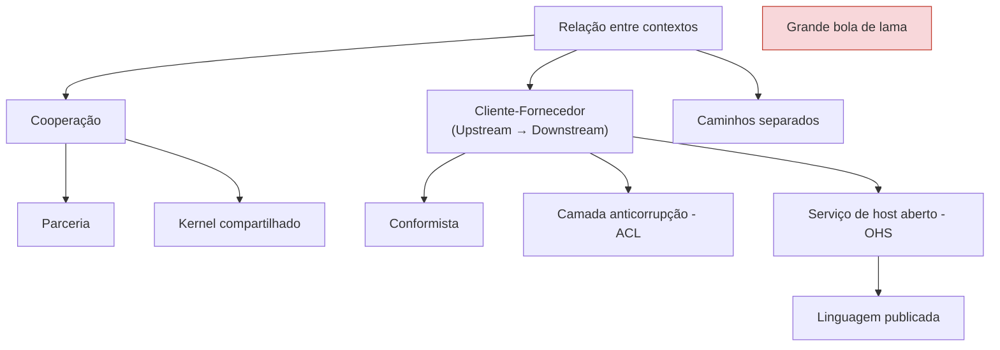

# DDD 04 - Trabalhando com contextos delimitados

← [[DDD 03 - Descoberta e formação do conhecimento]] · [[Domain Driven Design]] · Próxima → [[DDD 05 - Implementando arquitetura e lógica]]

> [!summary] Em uma frase
> O negócio vive de vários [[Contexto Delimitado|contextos]] integrados. Os [[Padrões de Integração entre Contextos|padrões de integração]] do DDD definem como cada par de contextos e de times se relaciona, e o [[Mapa de Contexto]] mostra o conjunto.

## Os padrões, organizados

| Padrão | Quem dita a integração | Ideia | Exemplo da aula |
|---|---|---|---|
| **Parceria** | Ninguém: os times combinam | Comunicação constante, cada time avisa e documenta as mudanças | Times da escola trabalhando em parceria (Figura 1) |
| **Kernel compartilhado** | Todos juntos | Parte do modelo e do código é comum, e qualquer mudança afeta e precisa ser testada em todos. **Desencorajado**, mas inevitável em legados e monólitos durante a modernização | CRM e Relatórios comuns aos times 1 e 2 |
| **Conformista** | Fornecedor (U) | O cliente (D) aceita o modelo do fornecedor como ele vem | Provedor externo de OAuth 2.0 |
| **ACL** | Ninguém cede | O cliente (D) cria uma camada que **traduz** o modelo do fornecedor para o seu | CRM traduzindo o protocolo de Identidade e Acesso |
| **OHS** | Cliente (D) tem preferência | O fornecedor (U) expõe um protocolo **aberto e estável**, separado da implementação interna | Contexto de Identidade e Acesso servindo os demais |
| **Linguagem publicada** | Cliente (D) | OHS mais uma linguagem ou versão personalizada por cliente | Mercado financeiro (adquirentes), logística (EDI), manufatura |
| **Caminhos separados** | Não há integração | Integrar custaria mais que duplicar | Cada time com seus próprios relatórios; também autenticação e logs |
| **Grande bola de lama** | Não se aplica | Sistema sem limites claros: cerque-o, não tente modelá-lo e não deixe que contamine os outros contextos | Sistemas muito grandes (Vernon, 2013) |

**U** = upstream (fornecedor, provê o serviço) · **D** = downstream (cliente, consome).

## Quando usar ACL (vale para prova)
1. O cliente (D) contém um **subdomínio principal**: a ACL evita que se corrompa ou interfira na solução principal, isolando os códigos.
2. O modelo do fornecedor (U) é **ineficiente ou não serve totalmente**: a ACL filtra só o necessário, o que é muito comum com **legado**.
3. O fornecedor (U) **muda o protocolo com frequência**: a manutenção fica concentrada na ACL.

## Mapa de contexto
É a representação visual dos contextos e de como eles se integram, com uma visão estratégica do todo. É um **documento vivo**. Veja [[Mapa de Contexto]].
