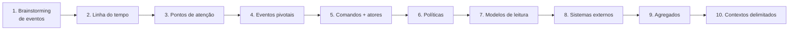

# DDD 06 - Event Storming

← [[DDD 05 - Implementando arquitetura e lógica]] · [[Domain Driven Design]] · Próxima → [[DDD 07 - Levantamento de requisitos]]

> [!summary] Em uma frase
> [[Event Storming]] (tempestade de eventos) é um workshop lúdico com post-its coloridos. Ele junta tudo o que veio antes: parte dos eventos do negócio e termina nos [[Agregado|agregados]] e [[Contexto Delimitado|contextos delimitados]].

## Preparação
- **Pessoas**: Domain Experts, ouvintes (o time) e um **facilitador**. É parecido com o [[Domain Storytelling]].
- **Material**: parede, post-its e canetas coloridas, ou então Miro ou FigJam.

## O passo a passo

1. **Brainstorming**: todos escrevem os [[Evento de Domínio|eventos de domínio]] que conseguirem, **no passado** ("Atividade entregue"), sem se preocupar com a ordem. Pare quando as ideias acabarem; dá para voltar depois.
2. **Linha do tempo**: ordene os eventos pelo caminho ideal e depois acrescente as exceções. Remova duplicados, corrija e complete.
3. **Pontos de atenção**: dúvidas, gargalos e críticas ao processo. Toda preocupação vira post-it, porque pode virar melhoria.
4. **Eventos pivotais**: eventos que mudam a fase ou o contexto. São marcados com **linhas verticais** e são **fortes indícios de contextos delimitados**.
5. **Comandos**: a ação que gerou o evento, escrita **no imperativo** ("Corrigir atividade"), com o **ator** ao lado. Nem todo comando tem ator.
6. **Políticas**: regras ou automações do tipo "quando *evento*, então *comando*". Podem ter uma condição.
7. **Modelos de leitura**: dados que o ator consulta **antes** de executar um comando (tela, relatório, e-mail, notificação).
8. **Sistemas externos**: o que está fora do domínio estudado.
9. **Agregados**: agrupe comandos e eventos pelo **objeto principal** (atividade, nota...).
10. **Contextos delimitados**: junte os agregados que têm ligação forte entre si (por políticas ou eventos).

## Legenda de cores (como na apostila)
| Cor do post-it | Elemento | Forma de escrever |
|---|---|---|
| 🟧 Laranja | Evento de domínio | Verbo no passado |
| 🩷 Rosa, girado em losango | Ponto de atenção | Dúvida ou crítica |
| 🟦 Azul | Comando | Verbo no imperativo |
| 🟨 Amarelo (pequeno, outro tom) | Ator | Função |
| 🟪 Roxo claro | Política | Regra de negócio |
| 🟩 Verde claro | Modelo de leitura | Fica antes do comando |
| 🩷 Rosa | Sistema externo | Nome do sistema |
| ┃ Linha vertical | Evento pivotal | Não se aplica |

> [!tip] Resumo do fluxo
> Ator consulta o **modelo de leitura**, executa o **comando**, que gera o **evento**, que dispara uma **política**, que executa outro **comando**, e assim por diante.

Exemplos de comandos da aula: Criar atividade (Professor), Realizar atividade (Aluno), Corrigir atividade (Professor), Gravar nota (Professor).
