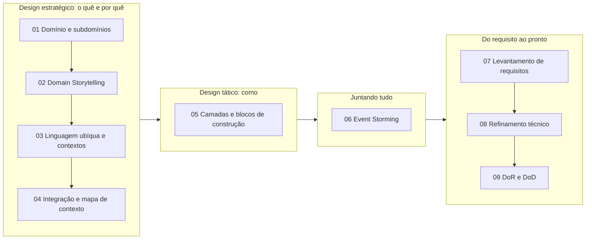

# Domain Driven Design

[[Fase 1 - Arquitetura de Software]] · Revisão → [[Revisão - Domain Driven Design]]

## A disciplina em um desenho

## Aulas
| # | Aula | Conceitos-chave |
|---|---|---|
| 1 | [[DDD 01 - Introdução ao Domain-Driven Design]] | [[O que é DDD]], [[Design Estratégico]], [[Domínio]], [[Subdomínios]], [[Domain Expert]] |
| 2 | [[DDD 02 - Domain Storytelling]] | [[Domain Storytelling]] |
| 3 | [[DDD 03 - Descoberta e formação do conhecimento]] | [[Linguagem Ubíqua]], [[Contexto Delimitado]] |
| 4 | [[DDD 04 - Trabalhando com contextos delimitados]] | [[Padrões de Integração entre Contextos]], [[Mapa de Contexto]], [[Upstream e Downstream]] |
| 5 | [[DDD 05 - Implementando arquitetura e lógica]] | [[Design Tático]], [[Camadas do DDD]], [[Objeto de Valor]], [[Entidade]], [[Agregado]], [[Serviço de Domínio]] |
| 6 | [[DDD 06 - Event Storming]] | [[Event Storming]], [[Evento de Domínio]] |
| 7 | [[DDD 07 - Levantamento de requisitos]] | [[Riscos de Produto (Marty Cagan)]], [[Upstream e Downstream]], [[Requisitos Funcionais e Não Funcionais]] |
| 8 | [[DDD 08 - Refinamento técnico]] | [[Refinamento Técnico]], [[Spike e POC]], [[Estimativas (Planning Poker e Monte Carlo)]] |
| 9 | [[DDD 09 - Definition of Ready e Definition of Done]] | [[Definition of Ready e Definition of Done]] |

## Cenários usados
- **Escola** (aulas 1 a 6): domínio Educação, recorte de entrega e correção de atividades.
- **CRM integrado** (aulas 7 a 9): troca do Excel por uma plataforma de cotações.

## Lab prático
[ddd-hexagonal](https://github.com/geancgbr/ddd-hexagonal): API de pedidos em Java com Objetos de Valor, Entidades, Agregado, Serviço de Domínio, Eventos de Domínio e Portas e Adaptadores. É código meu para praticar, não conteúdo da apostila.

## Material
PDFs em `~/Desktop/FASE 1/DDD/`. **As notas resumem apenas o conteúdo escrito nos PDFs**, sem acréscimos externos. As figuras dos PDFs (fluxogramas, mapas, post-its) não estão nas notas: quando uma nota cita uma figura, consulte o PDF.

## Referências
Evans (2003) · Vernon (2013) · Khononov (2021) · Millett & Tune (2015) · Fowler (2002) · Cockburn (2001) · Hofer & Schwentner (2021) · Cagan (2017)
