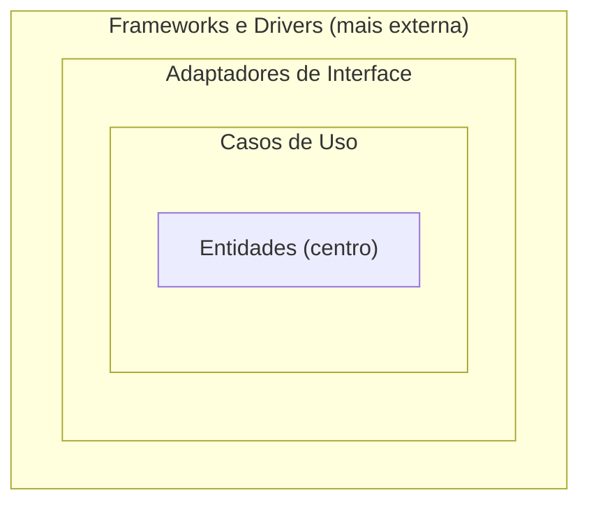

# Camadas da Arquitetura Limpa

O projeto é visto como **camadas de uma cebola**, não de um bolo: cada camada é um **grupo de componentes com responsabilidades semelhantes** (aula 1). O diagrama de referência é o de Martin (2019) (Figura 1 da aula 8).

| Camada | Papel | Componentes e exemplos |
|---|---|---|
| **Entidades** | Elementos da regra de negócio, com dados e regras de consistência | Estudante, Disciplina, CPF ([[Entidade]]) |
| **Casos de Uso** | Uma regra de negócio por componente; o "cérebro" | MatricularAluno ([[Casos de Uso]]) |
| **Adaptadores de Interface** | Intermediam e adaptam os dados nos dois sentidos | [[Controllers, Presenters e Gateways]] |
| **Frameworks e Drivers** | O mundo exterior: APIs, servidor, telas, acesso a repositórios. Também chamada de **camada de infraestrutura** | Rotas da API, servidor, conexões com repositórios ([[Detalhes na Arquitetura Limpa]]) |

**Regras de interação** (aula 8)
1. Os **internos não dependem nem acessam diretamente os externos**. Recebem o que precisam por **injeção de dependência**, por meio de uma **interface** que eles mesmos definem.
2. Componentes da **mesma camada** podem interagir (um caso de uso chama outro; um Controller usa um Adapter).

**Outras regras citadas**
- Só as **camadas exteriores podem instanciar** elementos das interiores (aula 2).
- Um caso de uso só usa **outros casos de uso ou entidades** (aula 2).
- Na camada de Casos de Uso, **nenhum código de conexão com banco de dados** (aula 1).

**Diferença para a [[Arquitetura Hexagonal]]** (aula 2): na Limpa, o que fica fora dos casos de uso se divide em **duas camadas**, a de interface e adaptadores e a mais externa, de implementação com o mundo exterior.

Aparece em: [[CA 01 - Introdução e SOLID]], [[CA 02 - Arquitetura Hexagonal e Arquitetura Limpa]], [[CA 05 - Adaptadores de interface e frameworks e drivers]], [[CA 08 - Revisão da disciplina]]
