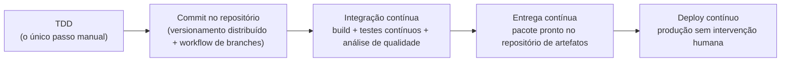

# DevOps (IaC and CI/CD)

[[Fase 2 - Gerenciamento de Kubernetes]] · Revisão → [[Revisão - DevOps (IaC and CI-CD)]]

Professor: **Fabiano da Silva Carneiro**. O nome da pasta usa "CI-CD" porque "/" não é permitido em nomes de arquivo.

## Aulas
| # | Aula | Conceitos-chave |
|---|---|---|
| 1 | [[DEV 01 - CI-CD principais conceitos]] | [[DevOps]], [[Integração Contínua (CI)]], [[Extreme Programming (XP)]], [[Entrega Contínua e Deploy Contínuo]] |
| 2 | [[DEV 02 - Melhores práticas com o GitHub]] | [[Controle de Versão]], [[Workflows de Branches (GitHub Flow, OneFlow, GitFlow)]] |
| 3 | [[DEV 03 - Testes automatizados com CI]] | [[Testes Contínuos]], [[TDD (Test-Driven Development)]] |
| 4 | [[DEV 04 - Qualidade do código-fonte]] | [[Qualidade do Código-Fonte]], [[Análise Estática de Código]], [[SonarQube]] |

## O fluxo em um desenho

O diagrama é só um mapa de navegação, montado a partir das aulas: a CI começa com o TDD (aula 3), e o deploy contínuo exige a entrega contínua (aula 1).

## Ligações com outras disciplinas
- **Fase 1**: [[TDD (Test-Driven Development)]], [[Teste de Unidade]] e [[Teste de Integração]] (Qualidade de Software); [[Análise Estática de Código]] e [[SonarQube]] (Desenvolvimento Seguro).
- **Fase 2**: [[GitHub Actions]], a disciplina sobre a ferramenta citada nos Hands On das aulas 2 e 3 (a aula 1 fala em "processo de integração contínua no Github").

## Material
PDFs em `~/Desktop/DevOps (IaC and CI:CD)/`. **As notas resumem apenas o conteúdo escrito nos PDFs.** O código YAML da aula 3 foi transcrito. As figuras (fluxos de CI, entrega contínua, workflows de branches e as figuras de testes da aula 3) não estão nas notas.

> [!note] Sobre "IaC"
> Apesar do nome da disciplina, **nenhuma das 4 aulas trata de IaC** (Infraestrutura como Código). A aula 2 só cita, de passagem, que o time de infraestrutura guarda no repositório "as automações de provisionamento de servidores". A IaC é tratada na disciplina [[Terraform]] ([[Infraestrutura como Código (IaC)]]).

## Referências
Beck (2004) · Duvall, Matyas e Glover (2007) · Humble e Farley (2014) · Kim et al. (2018) · Pires e Militão (2019) · Chacon e Straub (2014) · Driessen (2010) · Microsoft (2021)
