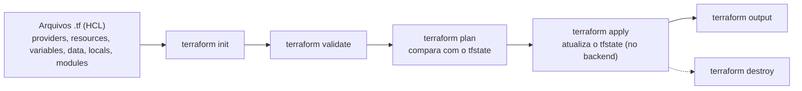

# Terraform

[[Fase 2 - Gerenciamento de Kubernetes]] · Revisão → [[Revisão - Terraform]]

## Aulas
| # | Aula | Conceitos-chave |
|---|---|---|
| 1 | [[TF 01 - Introdução ao Terraform]] | [[Infraestrutura como Código (IaC)]], [[HCL (HashiCorp Configuration Language)]] |
| 2 | [[TF 02 - Providers e backend]] | [[Providers do Terraform]], [[tfstate e Backend]] |
| 3 | [[TF 03 - Principais comandos]] | [[Comandos do Terraform]] |
| 4 | [[TF 04 - Variáveis e output]] | [[Variáveis, Outputs e Locals no Terraform]] |
| 5 | [[TF 05 - Data e locals]] | [[Data Sources no Terraform]], [[Variáveis, Outputs e Locals no Terraform]] |
| 6 | [[TF 06 - Módulos]] | [[Módulos do Terraform]] |
| 7 | [[TF 07 - Loops e expressões]] | [[Loops e Expressões no Terraform]] |
| 8 | [[TF 08 - Criação de infra com AWS]] | [[EKS (Elastic Kubernetes Service)]] |
| 9 | [[TF 09 - Terraform Cloud]] | [[Terraform Cloud]] |

## O fluxo de trabalho

O diagrama é só um mapa de navegação montado a partir das aulas 2 e 3.

## Ligações com outras disciplinas
- **DevOps (IaC and CI/CD)**: a IaC, que dá nome à disciplina, é desenvolvida aqui ([[Infraestrutura como Código (IaC)]]).
- **GitHub Actions**: o Terraform Cloud integra com o GitHub Actions ([[TF 09 - Terraform Cloud]]).
- **Kubernetes**: a aula 8 cria um cluster [[EKS (Elastic Kubernetes Service)|EKS]], e a aula 2 cita o provider `kubectl`.

## Material
PDFs em `~/Desktop/Terraform/`. **As notas resumem apenas o conteúdo escrito nos PDFs.** O HCL foi transcrito com aspas retas e indentação refeita. As saídas dos comandos (aula 3) e os exemplos de count (aula 7) estão em imagem. Na aula 8, os recursos foram resumidos em tabela; o código completo está no PDF.

## Referências
HashiCorp Developer (install, intro, providers, back-end, state, CLI, resources, import, variables, sensitive, outputs, locals, data sources, dependencies, modules, count, expressions, for_each, EKS, GitHub Actions, cloud) · Terraform Registry (EC2 module, aws_iam_role, aws_vpc)
